<a name="readme-top"></a>

<div align="center">

  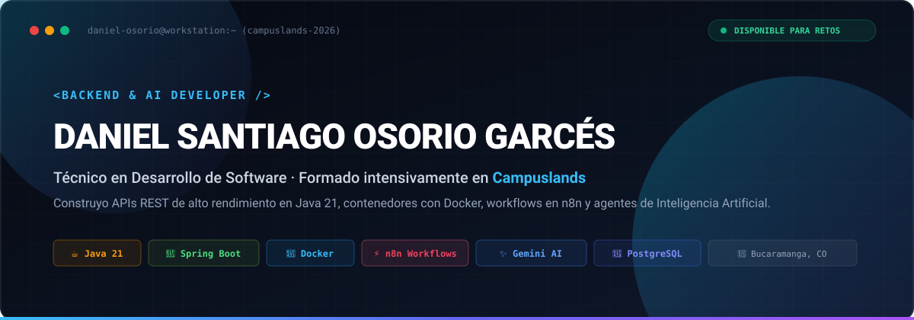

  <br/><br/>

  <!-- Insignias Dinámicas Principales -->
  <p>
    <a href="https://github.com/santiagoosorio0708e-wq"></a>
    <a href="https://github.com/santiagoosorio0708e-wq"></a>
    <a href="https://github.com/santiagoosorio0708e-wq"></a>
    
    
    
    
    
  </p>

  <!-- Botones de Acción Rápida -->
  <p>
    <a href="https://www.linkedin.com/in/daniel-santiago-osorio-garc%C3%A9s-03b7633a6/"></a>
    <a href="mailto:santiagoosorio0708e@gmail.com"></a>
    <a href="https://zingy-toffee-b7c66c.netlify.app"></a>
    <a href="https://drive.google.com/file/d/1bQABV_C9gZE0iSe6uRBOpIkgEr5aiXaP/view?usp=sharing"></a>
    <a href="https://drive.google.com/file/d/1xJmhhROu52DpJHZ2JbXHRRwl4OWtTp86/view?usp=sharing"></a>
    <a href="https://wa.me/573014609110"></a>
  </p>

</div>

<br/>

<!-- ========================================================================= -->
<!-- TABLA DE CONTENIDOS INTERACTIVA                                           -->
<!-- ========================================================================= -->
<details>
  <summary><strong> Tabla de Contenidos (Clic para desplegar)</strong></summary>
  <ol>
    <li><a href="#acerca-del-perfil">Acerca del Perfil</a></li>
    <li><a href="#habilidades-y-metodología">Habilidades y Metodología</a></li>
    <li><a href="#lenguajes-y-tecnologías">Lenguajes y Tecnologías</a></li>
    <li><a href="#en-qué-me-enfoco">En qué me enfoco</a></li>
    <li><a href="#proyectos-destacados">Proyectos Destacados (Simuladores, Backend &amp; IA)</a></li>
    <li><a href="#construido-con">Construido con</a></li>
    <li><a href="#arquitectura-del-sistema">Arquitectura del Sistema</a></li>
    <li><a href="#formación-y-experiencia">Formación y Experiencia</a></li>
    <li><a href="#prerrequisitos">Prerrequisitos</a></li>
    <li><a href="#instalación">Instalación</a></li>
    <li><a href="#uso-y-características">Uso y Características</a></li>
    <li><a href="#pruebas">Pruebas</a></li>
    <li><a href="#hoja-de-ruta">Hoja de Ruta (Roadmap con checkboxes)</a></li>
    <li><a href="#contacto">Contacto</a></li>
  </ol>
</details>

<br/>

---

## 📌 Acerca del Perfil

<div align="center">
  
</div>

<a href="https://zingy-toffee-b7c66c.netlify.app">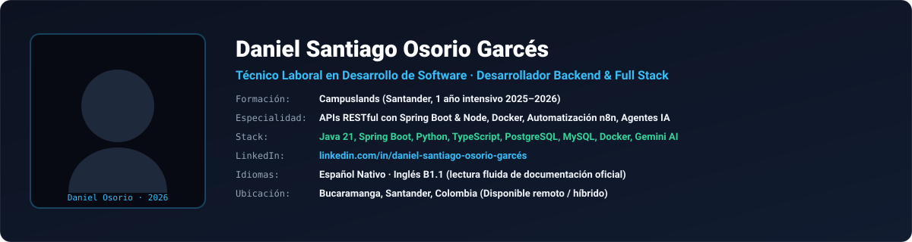</a>

Soy **Técnico Laboral en Desarrollo de Software**, formado durante un año intensivo de inmersión práctica en **Campuslands** (Bucaramanga/Floridablanca).

En palabras sencillas: **diseño y construyo la arquitectura invisible que hace que los sistemas funcionen rápido, de forma segura y sin interrupciones**. En lo técnico, eso significa estructurar **APIs RESTful con Java 21 y Spring Boot** bajo **Clean Architecture y arquitectura hexagonal**; orquestar flujos de eventos y automatizaciones de negocio en **n8n** conectadas mediante webhooks a Telegram, WhatsApp (Baileys) y Google Sheets; encapsular microservicios en **Docker y Docker Compose** para garantizar consistencia entre desarrollo y producción; e integrar **agentes de Inteligencia Artificial con Google Gemini** para resolver consultas en lenguaje natural sin inventar datos.

Manejo persistencia relacional estricta con **PostgreSQL y MySQL** (modelado entidad-relación, vistas, triggers y optimización de consultas SQL). Cada desarrollo lo entrego listo para que cualquier equipo lo opere: **pruebas de contratos de datos con Postman**, pruebas unitarias, ramas ordenadas bajo **GitFlow**, documentación técnica clara y despliegues continuos en **Render y Netlify**.

<p align="right">(<a href="#readme-top">Volver al inicio ⬆</a>)</p>

---

## 💡 Habilidades y Metodología

<div align="center">
  
</div>

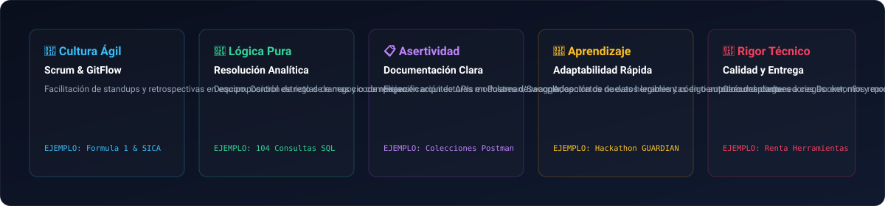

* **Cultura Ágil & Trabajo en Equipo (Scrum):** Experiencia en sprints colaborativos, estimación de historias de usuario, sincronización diaria y revisiones rigurosas de código (*Code Reviews*).
* **Pensamiento Lógico & Descomposición Analítica:** Habilidad para descomponer reglas de negocio complejas en módulos desacoplados y comprensibles.
* **Comunicación Técnica Asertiva:** Documentación de APIs en Postman/Swagger, alineación clara entre requerimientos funcionales y contratos de datos JSON.
* **Aprendizaje Acelerado & Adaptabilidad:** Asimilación inmediata de herramientas de nube, contenedores Docker y librerías de IA generativa.
* **Rigor y Calidad en la Entrega:** Tolerancia cero al código no testeado; validación de esquemas de datos, control de excepciones y aislamiento de dependencias.

<p align="right">(<a href="#readme-top">Volver al inicio ⬆</a>)</p>

---

## 💻 Lenguajes y Tecnologías

<div align="center">
  
</div>

<p align="center">
  <a href="https://github.com/santiagoosorio0708e-wq/Formula1-java/tree/develop/src"></a>
  <a href="https://github.com/santiagoosorio0708e-wq/chatbot-futbol"></a>
  <a href="https://github.com/santiagoosorio0708e-wq/Vital-Route/tree/master/api"></a>
  <a href="https://github.com/santiagoosorio0708e-wq/Banco-ACME/tree/main/js"></a>
  <a href="https://github.com/santiagoosorio0708e-wq/consultas-postgres">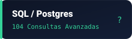</a>
</p>

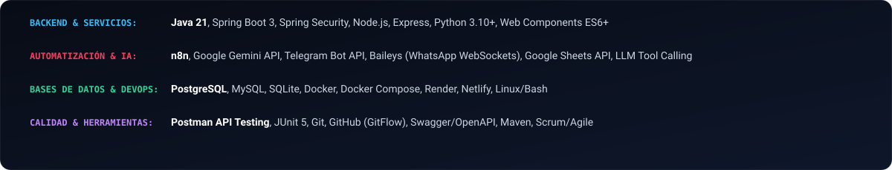

<sub>*Haz clic en cualquiera de los botones de lenguajes superiores para inspeccionar directamente el código fuente y las carpetas del repositorio donde apliqué cada tecnología.*</sub>

<p align="right">(<a href="#readme-top">Volver al inicio ⬆</a>)</p>

---

## 🎯 En qué me enfoco

<div align="center">
  
</div>

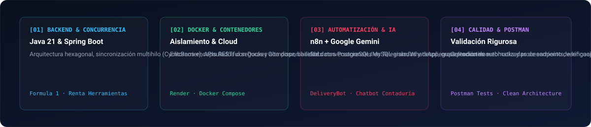

<p align="right">(<a href="#readme-top">Volver al inicio ⬆</a>)</p>

---

## 🚀 Proyectos Destacados

<div align="center">
  
</div>

<div align="center">

<a href="https://github.com/santiagoosorio0708e-wq/Formula1-java">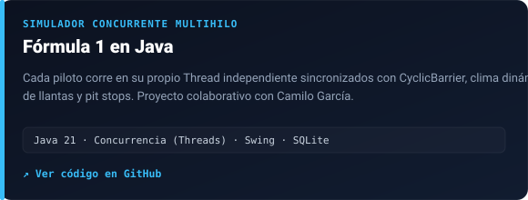</a>
<a href="https://github.com/santiagoosorio0708e-wq/Banco-ACME">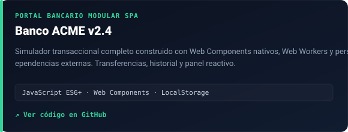</a>
<a href="https://github.com/santiagoosorio0708e-wq/delivery-bot">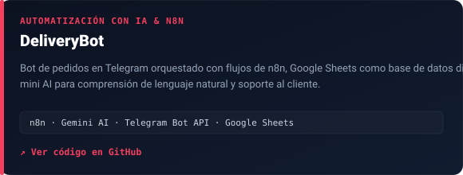</a>
<a href="https://github.com/santiagoosorio0708e-wq/Vital-Route"></a>
<a href="https://github.com/santiagoosorio0708e-wq/Proyecto_RentaHerramientas_OsorioDaniel_GarciaCamilo">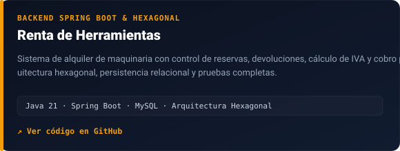</a>
<a href="https://github.com/santiagoosorio0708e-wq/chatbot-contaduria"></a>
<a href="https://github.com/santiagoosorio0708e-wq/empresa-viajes">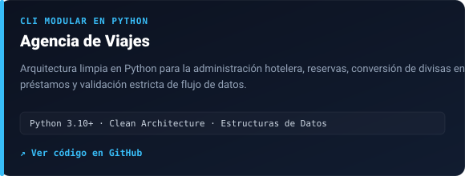</a>
<a href="https://github.com/CamiloGarcia079/Aduana-Copilot-CamiloGarcia-DanielOsorio">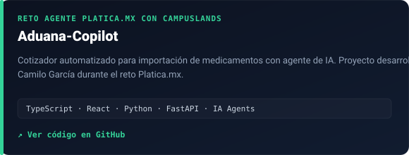</a>

</div>

<br/>

### Matriz Comparativa de Proyectos

| Proyecto | Qué resuelve | Arquitectura y Tecnologías Clave | Código / Demostración |
|:---|:---|:---|:---|
| **[Fórmula 1 en Java](https://github.com/santiagoosorio0708e-wq/Formula1-java)** | Simulación matemática en tiempo real de una carrera de F1. Cada monoplaza corre en su propio `Thread`, sincronizados por `CyclicBarrier`, con telemetría de neumáticos, combustible, lluvia dinámica y cálculo de *pit stops*. Desarrollado en pareja con Camilo García. | Java 21, Concurrencia multihilo, Swing GUI, SQLite. | [Ver Código](https://github.com/santiagoosorio0708e-wq/Formula1-java) |
| **[Banco ACME v2.4](https://github.com/santiagoosorio0708e-wq/Banco-ACME)** | Portal transaccional financiero modular tipo SPA (Single Page Application) sin librerías externas. Gestión de cuentas, transferencias seguras, validaciones de saldo e historial en vivo. | JavaScript ES6+, Web Components nativos, Web Workers, CSS Glassmorphism. | [Ver Código](https://github.com/santiagoosorio0708e-wq/Banco-ACME) · [Probar en Portafolio](https://zingy-toffee-b7c66c.netlify.app/#demo-studio) |
| **[DeliveryBot Automatizado](https://github.com/santiagoosorio0708e-wq/delivery-bot)** | Sistema autónomo de recepción y seguimiento de pedidos por Telegram. Utiliza Gemini AI para interpretar órdenes en lenguaje natural y Google Sheets como motor dinámico de inventario y base de datos. | n8n Workflows, Telegram Bot API, Google Gemini AI, Google Sheets API. | [Ver Código](https://github.com/santiagoosorio0708e-wq/delivery-bot) |
| **[Vital-Route](https://github.com/santiagoosorio0708e-wq/Vital-Route)** | Plataforma de trazabilidad y ruteo logístico para optimización de entregas y control de despachos en tiempo real. | TypeScript, Node.js, Express, Clean Architecture, APIs RESTful. | [Ver Código](https://github.com/santiagoosorio0708e-wq/Vital-Route) |
| **[Renta de Herramientas](https://github.com/santiagoosorio0708e-wq/Proyecto_RentaHerramientas_OsorioDaniel_GarciaCamilo)** | Backend empresarial para alquiler de maquinaria industrial, cálculo de IVA, penalizaciones por retrasos y reportes de averías. Proyecto en pareja con Camilo García. | Java 21, Spring Boot 3, MySQL, Arquitectura Hexagonal, JUnit. | [Ver Código](https://github.com/santiagoosorio0708e-wq/Proyecto_RentaHerramientas_OsorioDaniel_GarciaCamilo) |
| **[Chatbot Contaduría & Fútbol](https://github.com/santiagoosorio0708e-wq/chatbot-contaduria)** | Agente conversacional conectado a WhatsApp (Baileys) para asesoría contable automatizada, y chatbot con análisis de sentimientos sobre opiniones deportivas con Gemini. | Google Gemini API, WhatsApp WebSockets (Baileys), Python, NLP. | [Ver Código](https://github.com/santiagoosorio0708e-wq/chatbot-contaduria) |
| **[Empresa de Viajes](https://github.com/santiagoosorio0708e-wq/empresa-viajes)** | Aplicación integral de consola para gestión de vuelos, alojamiento hotelero, préstamos y conversión de monedas internacionales con arquitectura modular. | Python 3.10+, Clean Architecture, Manejo estricto de excepciones. | [Ver Código](https://github.com/santiagoosorio0708e-wq/empresa-viajes) |
| **[104 Consultas PostgreSQL](https://github.com/santiagoosorio0708e-wq/consultas-postgres)** | Repositorio de analítica avanzada sobre bases de datos relacionales complejas: subconsultas correlacionadas, funciones de ventana, triggers de auditoría y vistas indexadas. | PostgreSQL, PL/pgSQL, Modelado Relacional. | [Ver Código](https://github.com/santiagoosorio0708e-wq/consultas-postgres) |
| **[Portafolio Interactivo](https://github.com/santiagoosorio0708e-wq/Portafolio)** | Plataforma web personal que incluye simulador de proyectos en vivo estilo GIF y modo interactivo a 60 FPS, terminal CLI ejecutable y reproductor de audio Web Audio API. | Vanilla JavaScript ES6+, HTML5 Semántico, CSS3 Tokens, Netlify CI/CD. | [Ver Código](https://github.com/santiagoosorio0708e-wq/Portafolio) · [Demo en Vivo](https://zingy-toffee-b7c66c.netlify.app) |

<p align="right">(<a href="#readme-top">Volver al inicio ⬆</a>)</p>

---

## 🛠 Construido con

El ecosistema de ingeniería y las tecnologías fundamentales con las que diseño, implemento y despliego mis desarrollos comprenden:

### Backend, Concurrencia y Lenguajes
* [](https://www.oracle.com/java/)
* [](https://spring.io/projects/spring-boot)
* [](https://nodejs.org/)
* [](https://www.python.org/)
* [](https://www.typescriptlang.org/)
* [](https://developer.mozilla.org/es/docs/Web/JavaScript)

### Automatización e Inteligencia Artificial
* [](https://n8n.io/)
* [](https://ai.google.dev/)
* [](https://core.telegram.org/bots/api)
* [](https://developers.google.com/sheets/api)

### Contenerización, DevOps e Infraestructura
* [](https://www.docker.com/)
* [](https://docs.docker.com/compose/)
* [](https://render.com/)
* [](https://www.netlify.com/)
* [](https://git-scm.com/)

### Bases de Datos y Calidad de Código
* [](https://www.postgresql.org/)
* [](https://www.mysql.com/)
* [](https://www.postman.com/)

<p align="right">(<a href="#readme-top">Volver al inicio ⬆</a>)</p>

---

## 🏛 Arquitectura del Sistema

La organización de repositorios y proyectos que integran mi perfil técnico sigue una estructura modular orientada a la separación de responsabilidades y la reproducibilidad:

```text
santiagoosorio0708e-wq/
│
├── ☕ backend-java/
│   ├── Formula1-java/                       # Simulador multihilo concurrente (Java 21, Swing, SQLite)
│   ├── Proyecto_RentaHerramientas/          # API REST empresarial (Spring Boot 3, Hexagonal, MySQL)
│   └── gestion-tareas-base-datos-Scrum/     # Sistema de gestión de tareas ágiles con persistencia
│
├── 🐳 devops-microservicios/
│   ├── Dockerfile                           # Definición de entornos aislados de ejecución
│   ├── docker-compose.yml                   # Orquestación de contenedores (App + Postgres + n8n)
│   └── Vital-Route/                         # Microservicio logístico en TypeScript & REST
│
├── ⚡ automatizacion-ia/
│   ├── delivery-bot/                        # Bot en Telegram orquestado con n8n y Google Sheets
│   ├── chatbot-contaduria/                  # Asistente en WhatsApp (Baileys) con Google Gemini
│   ├── chatbot-futbol/                      # Análisis de sentimientos de opiniones con IA
│   └── analisis-CV/                         # Pipeline de evaluación de hojas de vida con NLP
│
├── 🌐 web-transaccional/
│   ├── Banco-ACME/                          # SPA financiera pura con Web Components nativos y Workers
│   ├── E-commerce/                          # Catálogo dinámico responsivo con checkout
│   └── Portafolio/                          # Plataforma interactiva personal desplegada en Netlify
│
├── 🗄 persistencia-sql/
│   ├── consultas-postgres/                  # 104 consultas avanzadas, triggers, funciones y vistas
│   └── Pizzeria-don-picoloSQL/              # Modelado relacional normalizado y transacciones
│
└── 📄 cv/                                   # Hojas de vida y certificaciones
    ├── HojaDeVida_ATS_DanielOsorio.pdf      # Formato ATS para plataformas de selección
    └── HojaDeVida_Campuslands_DanielOsorio.pdf # Formato institucional oficial de Campuslands
```

<p align="right">(<a href="#readme-top">Volver al inicio ⬆</a>)</p>

---

## 🎓 Formación y Experiencia

<div align="center">
  
</div>

<table>
  <tr>
    <td width="96" align="center"></td>
    <td>
      <b>Técnico Laboral en Desarrollo de Software · Campuslands</b><br/>
      <sub>Floridablanca, Santander · 2025 – 2026 · Formación intensiva práctica de 1 año (1,000+ horas)</sub><br/>
      Entrenamiento de inmersión en arquitectura de software backend con Java y Spring Boot, desarrollo web con JavaScript/TypeScript, microservicios con Docker, orquestación en n8n, bases de datos relacionales PostgreSQL y MySQL, integración de Inteligencia Artificial (Gemini API) y gestión de proyectos bajo el marco Scrum.
    </td>
  </tr>
  <tr>
    <td width="96" align="center"><sub>RETO</sub><br/><b>2026</b></td>
    <td>
      <b>Reto Agente Platica.mx con Campuslands · <a href="https://github.com/CamiloGarcia079/Aduana-Copilot-CamiloGarcia-DanielOsorio">Aduana-Copilot</a></b><br/>
      Desarrollo en pareja con Camilo García de un cotizador de importación de medicamentos asistido por un agente de Inteligencia Artificial. Construcción de contratos de datos, lógica de backend y motor de cotización.
    </td>
  </tr>
  <tr>
    <td width="96" align="center"><sub>HACKATHON</sub><br/><b>IA</b></td>
    <td>
      <b>Hackathon Presencial "Visual Agents" · <a href="https://github.com/andresguerra321/GUARDIAN">GUARDIAN</a></b><br/>
      Sistema predictivo de seguridad vial mediante visión por computadora (FiftyOne de Voxel51) y Google Gemini. Participación en el diseño de arquitectura, integración de componentes backend y validación de predicciones.
    </td>
  </tr>
  <tr>
    <td width="96" align="center"><sub>UIS</sub><br/><b>2025</b></td>
    <td>
      <b>Bachiller Académico · Fundación Colegio UIS</b><br/>
      <sub>Bucaramanga · Formación académica con alto rigor lógico, pensamiento analítico, matemáticas y fundamentos de computación.</sub>
    </td>
  </tr>
</table>

<p align="right">(<a href="#readme-top">Volver al inicio ⬆</a>)</p>

---

## 📋 Prerrequisitos

Para clonar, ejecutar o inspeccionar localmente cualquiera de los proyectos listados en este perfil, se recomienda contar con las siguientes herramientas instaladas:

* **Java Development Kit (JDK):** Versión 21 LTS instalada y configurada en `JAVA_HOME`.
* **Docker & Docker Compose:** Docker Engine v24+ o Docker Desktop para levantar contenedores y bases de datos aisladas.
* **Node.js & npm:** Versión 20 LTS o superior.
* **Python Runtime:** Versión 3.10 o superior (para los proyectos de analítica y CLI).
* **Gestor de Bases de Datos:** PostgreSQL 15+ o MySQL 8.0 (o ejecutar las instancias provistas en Docker).
* **Cliente de APIs:** Postman Desktop o CLI (`newman`) para ejecución de colecciones.
* **Control de Versiones:** Git 2.40+ configurado localmente.

<p align="right">(<a href="#readme-top">Volver al inicio ⬆</a>)</p>

---

## 🚀 Instalación

Para desplegar localmente cualquier repositorio de este perfil mediante terminal:

```bash
# 1. Clonar el repositorio deseado
git clone https://github.com/santiagoosorio0708e-wq/NOMBRE_DEL_REPOSITORIO.git

# 2. Acceder al directorio del proyecto
cd NOMBRE_DEL_REPOSITORIO

# 3. En proyectos con Docker Compose (Backend + PostgreSQL / MySQL):
docker compose up -d --build

# 4. Verificar el estado de los contenedores
docker ps

# 5. Para proyectos Java (Spring Boot con Maven):
./mvnw clean install
./mvnw spring-boot:run

# 6. Para proyectos Node.js / TypeScript:
npm install
npm run dev
```

<p align="right">(<a href="#readme-top">Volver al inicio ⬆</a>)</p>

---

## ⚡ Uso y Características

Los repositorios de este perfil se estructuran en torno a casos de uso de ingeniería de software reales:

### 1. Backend Concurrente y APIs RESTful
* **Concurrencia multihilo en Java:** Coordinación de hilos independientes con barreras de sincronización (`CyclicBarrier`), prevención de condiciones de carrera (*race conditions*) y consistencia de datos en memoria y SQLite.
* **Microservicios desacoplados:** Implementación del patrón de arquitectura hexagonal con puertos y adaptadores, separando lógica de dominio de frameworks de persistencia y controladores web.

### 2. Aislamiento y Contenerización con Docker
* **Consistencia de entornos:** Todos los servicios dependientes de motores de base de datos relacionales se entregan con archivos `docker-compose.yml` listos para reproducir los ambientes sin contaminar la máquina anfitriona.

### 3. Automatización de Procesos y Agentes de IA
* **Pipelines en n8n:** Recepción de *webhooks*, transformación de estructuras JSON complejas y almacenamiento persistente en tiempo real.
* **Modelos LLM Aplicados:** Uso de la API de Google Gemini mediante *prompts* con contexto enriquecido y *tool calling* estructurado.

<p align="right">(<a href="#readme-top">Volver al inicio ⬆</a>)</p>

---

## 🧪 Pruebas

Para garantizar la estabilidad, mantenibilidad y robustez de los sistemas desarrollados:

* **Validación de APIs con Postman:** Colecciones parametrizadas de pruebas que verifican automáticamente códigos de estado HTTP (200, 201, 400, 404, 500), tiempos de respuesta y contratos de esquema JSON.
* **Pruebas Unitarias:** Verificación de métodos de negocio y servicios en Java con JUnit 5 y aserciones estrictas.
* **Entornos de Prueba Aislados:** Ejecución de pruebas de persistencia sobre bases de datos en contenedores Docker efímeros para evitar inconsistencias de datos residuales.
* **Flujos de GitFlow:** Cada funcionalidad o corrección pasa por ramas de `feature/` o `fix/` antes de integrarse a la rama principal previa revisión.

```bash
# Ejecución de pruebas unitarias en proyectos Java
./mvnw test

# Inspección de logs en contenedores activos
docker compose logs -f app
```

<p align="right">(<a href="#readme-top">Volver al inicio ⬆</a>)</p>

---

## 🗺 Hoja de Ruta (Roadmap con checkboxes)

- [x] Titulación técnica intensiva en Campuslands (1,000+ horas de formación práctica en backend, frontend, bases de datos y Scrum).
- [x] Desarrollo y despliegue del simulador interactivo del portafolio web a 60 FPS en Netlify.
- [x] Construcción del simulador multihilo concurrente de Fórmula 1 en Java 21 (en colaboración con Camilo García).
- [x] Creación del portal bancario transaccional modular Banco ACME con Web Components nativos en JavaScript.
- [x] Implementación de DeliveryBot: automatización integral con n8n, Google Sheets y Google Gemini AI.
- [x] Desarrollo de servicios REST con arquitectura hexagonal y Spring Boot (Renta de Herramientas).
- [x] Participación en Retos de IA (Aduana-Copilot con Platica.mx y Hackathon Visual Agents GUARDIAN).
- [x] Estandarización y publicación de Hojas de Vida en formato ATS y formato oficial Campuslands.
- [ ] Orquestación avanzada de microservicios con Kubernetes y Helm Charts.
- [ ] Integración de pipelines de CI/CD automatizados con GitHub Actions para despliegue de imágenes en Docker Hub.

<p align="right">(<a href="#readme-top">Volver al inicio ⬆</a>)</p>

---

## 📬 Hojas de Vida y Contacto

<div align="center">
  
</div>

* **Ubicación:** Bucaramanga, Santander, Colombia (Disponible para trabajo remoto e híbrido)
* **LinkedIn:** [linkedin.com/in/daniel-santiago-osorio-garcés](https://www.linkedin.com/in/daniel-santiago-osorio-garc%C3%A9s-03b7633a6/)
* **Correo Electrónico:** [santiagoosorio0708e@gmail.com](mailto:santiagoosorio0708e@gmail.com)
* **WhatsApp Directo:** [+57 301 460 9110](https://wa.me/573014609110)
* **Portafolio Web:** [zingy-toffee-b7c66c.netlify.app](https://zingy-toffee-b7c66c.netlify.app) *(Incluye simulador interactivo de proyectos en vivo y consola de terminal)*
* **Perfil de GitHub:** [@santiagoosorio0708e-wq](https://github.com/santiagoosorio0708e-wq)
* **Hoja de Vida ATS (Google Drive):** [Abrir en Google Drive ↗](https://drive.google.com/file/d/1bQABV_C9gZE0iSe6uRBOpIkgEr5aiXaP/view?usp=sharing)
* **Hoja de Vida ATS (Descarga directa PDF):** [Descargar HojaDeVida_ATS_DanielOsorio.pdf](cv/HojaDeVida_ATS_DanielOsorio.pdf)
* **Hoja de Vida Campuslands (Google Drive):** [Abrir en Google Drive ↗](https://drive.google.com/file/d/1xJmhhROu52DpJHZ2JbXHRRwl4OWtTp86/view?usp=sharing)
* **Hoja de Vida Campuslands (Descarga directa PDF):** [Descargar HojaDeVida_Campuslands_DanielOsorio.pdf](cv/HojaDeVida_Campuslands_DanielOsorio.pdf)

<br/>

<div align="center">
  
</div>

<p align="right">(<a href="#readme-top">Volver al inicio ⬆</a>)</p>
